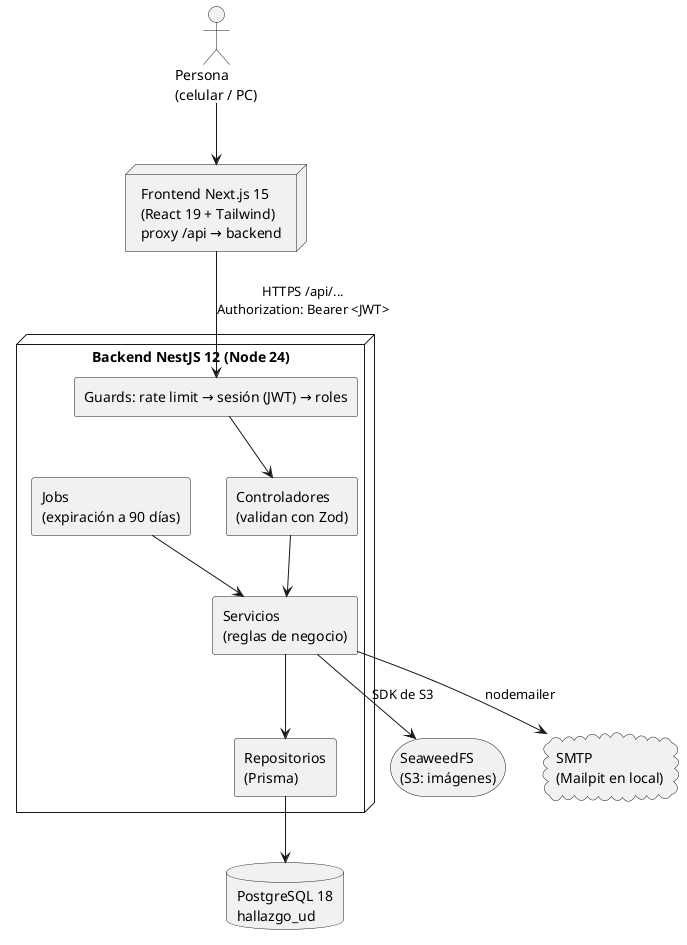

# Arquitectura

**Monolito modular en capas**, cliente-servidor con API REST (decisión de la sección 4 de `CLAUDE.md`): un solo backend, organizado por módulos, que se podrían separar más adelante si hiciera falta.

## Vista general



Pégalo en [plantuml.com/plantuml](https://www.plantuml.com/plantuml) para verlo como imagen.

## Tecnologías

| Pieza | Tecnología | Por qué (resumen; detalle en `CLAUDE.md` §4) |
|---|---|---|
| Backend | NestJS 12 + TypeScript, Node.js 24 LTS | Módulos, inyección de dependencias y capas de fábrica |
| Validación | Zod (Pipe `ValidacionZod`) | Un esquema por endpoint; mensajes en español |
| Base de datos | PostgreSQL 18 + Prisma 7 | Relacional, búsqueda en español, migraciones versionadas |
| Imágenes | SeaweedFS (compatible con S3) + Sharp | Fuera del servidor; miniaturas WEBP |
| Correo | Nodemailer (Mailpit en local) | Activación, recuperación y avisos |
| Sesión | JWT + bcrypt | Sin estado en el servidor (RNF-15) |
| Pruebas | Vitest + Supertest | Unitarias, e2e y contra PostgreSQL real |
| Calidad | oxlint + Prettier + husky | Revisión en cada commit |
| Contenedores | Docker Compose | Mismo entorno en el PC y en el VPS |

## Capas

```
controlador  →  servicio  →  repositorio  →  Prisma  →  PostgreSQL
```

| Capa | Hace | No hace |
|---|---|---|
| **Controlador** (`*.controller.ts`) | Recibe la petición, valida con Zod, toma el usuario de la sesión y la IP, llama al servicio | Reglas de negocio, consultas a la base |
| **Servicio** (`*.service.ts`) | Reglas de negocio (§6), transacciones, decide permisos por relación (autor, partes) | Hablar HTTP, escribir SQL |
| **Repositorio** (`*.repository.ts`) | Consultas: Prisma tipado o SQL parametrizado (`Prisma.sql`) | Reglas de negocio |

Cada pieza recibe la siguiente por el **constructor** (inyección de dependencias). Por eso en las pruebas se reemplaza un repositorio por uno falso y el servicio se prueba sin base de datos.

## Módulos (`backend/src/`)

| Carpeta | Contenido |
|---|---|
| `modules/salud` | `/salud` y `/salud/bd` |
| `modules/auth` | Registro, verificación, login, bloqueo por intentos, recuperación, perfil y foto |
| `modules/publicaciones` | Catálogo y detalle; crear, editar y retirar; imágenes; **máquina de estados** (`estados.ts`, el único lugar con las transiciones permitidas) |
| `modules/coincidencias` | Puntaje puro (`puntaje.ts`), prefiltro SQL, sugerencias y aviso al publicar |
| `modules/reclamaciones` | Reclamar, aceptar o rechazar, chat y entrega |
| `modules/notificaciones` | Avisos en la app y por correo (global) |
| `modules/moderacion` | Reportes y bandeja del moderador |
| `modules/admin` | Catálogos, cuentas y estadísticas |
| `jobs` | Expiración a 90 días (`expiracion.service.ts`) y el reloj que la dispara cada día a las 3:00 a. m. hora de Colombia (`programador.service.ts`, con `node-cron`) |
| `lib/prisma` | Cliente de Prisma como provider global |
| `lib/auditoria` | Registro en `auditoria`, dentro de la misma transacción |
| `lib/correo` | Envío de correos y plantillas |
| `lib/almacenamiento` | SeaweedFS (S3) |
| `lib/imagenes` | Validación y procesamiento con Sharp |
| `comun/` | Guards (sesión, roles), Pipe de Zod, filtro de errores, logger, rate limit |
| `config/` | Variables de entorno validadas con Zod: si falta una, el servidor no arranca |

## Recorrido de una petición

Ejemplo: `PATCH /api/reclamaciones/7` con `{ "decision": "ACEPTAR" }`.

1. **Rate limit**: ¿esta IP pasó de 100 peticiones por minuto? → `429`.
2. **Sesión**: lee el JWT y deja `{ id, rol }` en la petición. Token malo → `401`.
3. **Roles**: la ruta pide sesión (`@Autenticado`). Sin sesión → `401`.
4. **Pipe de Zod**: `decision` debe ser `ACEPTAR` o `RECHAZAR` → si no, `400` con `detalles`.
5. **Servicio** (`ReclamacionesService.resolver`), en **una transacción**:
   1. bloquea la reclamación (`FOR UPDATE`) y comprueba que quien pide es el autor y que está pendiente;
   2. la marca `ACEPTADA` (`fecha_resolucion = now()`);
   3. cambia la publicación a `EN_RECLAMACION` por la máquina de estados, que también escribe `historial_estado`;
   4. crea la entrega vacía;
   5. escribe en `auditoria`.
   Si cualquier paso falla, **se deshace todo**.
6. **Después** de la transacción: aviso al reclamante (en la app y por correo). Si el aviso falla, la aceptación ya quedó hecha.
7. **Errores**: cualquier error pasa por el filtro global y sale como `{ error: { codigo, mensaje } }`; los 500 sin detalles internos.

## Seguridad

| Riesgo | Medida |
|---|---|
| Robo de cuentas por fuerza bruta | 5 intentos fallidos → bloqueo de 15 min por cuenta; 5 peticiones/min por IP en login y registro |
| Revelar qué correos existen | Mismo mensaje en el login; `recuperar` responde igual exista o no |
| Contraseñas filtradas | bcrypt con coste 12; nunca salen de la base |
| Enlaces robados | Solo se guarda el SHA-256 del token; un solo uso; 24 h o 1 h |
| Fuga de datos personales | `select` explícito en cada consulta; de otras personas solo `{ id, nombre }`; prueba anti-fuga que recorre las respuestas |
| Fuga del detalle reservado | Tabla aparte; solo lo lee el autor; nunca en avisos ni correos |
| Inyección SQL | Prisma y `Prisma.sql` con parámetros; probado con `'; DROP TABLE usuario; --` |
| XSS en correos | Todo lo que escribe un usuario se escapa en el HTML |
| Archivos maliciosos | Se revisa el tipo por los bytes; se reconvierte a WEBP; se borran los metadatos (GPS) |
| Acceso a datos ajenos | Los permisos por relación (autor, partes) se revisan en el servicio; responder "no existe" en vez de "no es tuyo" cuando conviene no revelar |
| Daño a la base desde el backend | En producción, rol `hallazgo_app` sin DROP ni UPDATE/DELETE en `auditoria` |
| Trazabilidad | `auditoria` inmutable + `historial_estado` |
| Secretos en el código | Todo en `.env` (fuera de Git); en producción se rechazan los valores de ejemplo |

## Decisiones de diseño importantes

- **Avisos fuera de la transacción.** Un correo no se puede "deshacer". Por eso los avisos se envían cuando la acción ya se guardó, y si fallan no la deshacen (`NotificacionesService.avisar` nunca lanza).
- **Concurrencia con `FOR UPDATE`.** Cada operación que lee un estado y luego lo cambia bloquea la fila. Hay pruebas que lanzan dos peticiones simultáneas, y pruebas "de mutación" que demuestran que sin el bloqueo fallan.
- **La base como última barrera.** Las reglas críticas también están en la base: CHECK, índices parciales y triggers. Ver [`modelo-datos.md`](modelo-datos.md).
- **Una sola máquina de estados.** Todo cambio de estado de una publicación pasa por `PublicacionesService.cambiarEstado` (o `cambiarEstadoEn` dentro de otra transacción).
- **Regla de fechas.** Dos fechas que se comparan en un CHECK salen del mismo reloj. Ver [`modelo-datos.md`](modelo-datos.md#regla-de-fechas).

## Pruebas

| Comando | Qué prueba | Base de datos |
|---|---|---|
| `npm test` | Servicios y funciones puras con dependencias falsas | No |
| `npm run test:e2e` | La app completa por HTTP (salud, errores, roles, límites) | La de desarrollo, solo lectura |
| `npm run test:db` | Flujos completos por HTTP y restricciones, contra PostgreSQL real | Crea `hallazgo_test_<carpeta>_<pid>` y la **borra al terminar** |

Estado (2026-11-21): **276 unitarias, 26 e2e y 142 contra la base**, todas en verde; cobertura de los servicios: 87 % (mínimo 60 %, `npm run test:cov`). Detalle de cada archivo y cómo escribir una prueba: [`pruebas.md`](pruebas.md).

Para que dos corridas no se pisen, cada una usa su propia base. Pero `npm install` y las pruebas **no deben correr a la vez en la misma carpeta**: se pisan `node_modules` y el cliente de Prisma queda a medias (síntoma: *"Property '$queryRaw' does not exist"*; arreglo: `npx prisma generate`).

## Entorno local

Ver el [`README.md`](../README.md) para levantarlo. Resumen de servicios:

| Servicio | Puerto local | Para qué |
|---|---|---|
| PostgreSQL | 5433 | Base de datos |
| SeaweedFS S3 | 8333 | Imágenes |
| SeaweedFS explorador | 8888 | Ver los archivos (sin contraseña: solo en local) |
| Mailpit SMTP / web | 1025 / 8025 | Ver los correos sin enviarlos de verdad |
| Backend | 3000 | API |

Requisitos de memoria: Docker con estos tres servicios y el backend funciona bien. Si además corre otro clúster pesado (por ejemplo k3d), el PC puede quedarse sin RAM y Docker se reinicia solo.

## Trabajo en paralelo

Cuando trabajan dos personas (o sesiones) a la vez:
- cada una en su **`git worktree`**, en su propia rama `feature/*`;
- para usar la carpeta principal (merge, `npm install`, pruebas), se **anuncia**, se **espera respuesta** y al terminar se avisa "carpeta libre";
- las ramas se unen a `main` con `git merge --ff-only`, después de verificar en el worktree.

## Despliegue (pendiente, Fase K)

Plan: un VPS con Docker Compose.
1. Dockerfiles de producción (backend compilado; frontend con `next build` + `next start`, que tiene su propio servidor).
2. Proxy inverso con HTTPS (TLS) delante de Next.js. Backend con `TRUST_PROXY=1` y frontend con `CONFIAR_PROXY=true`: así el rate limit cuenta por la IP real y nadie puede inventarla (ver `backend/src/comun/limites/limites.ts`).
3. No publicar los puertos de PostgreSQL, el explorador de SeaweedFS ni Mailpit.
4. Backend con `DATABASE_URL` = `hallazgo_app`; migraciones con `DATABASE_URL_MIGRACIONES` = dueño (`prisma migrate deploy`).
5. Cron diario de `infra/respaldo/respaldar.sh` y una copia fuera del servidor.
6. CI en GitHub Actions: lint + las tres baterías de pruebas en cada PR.
